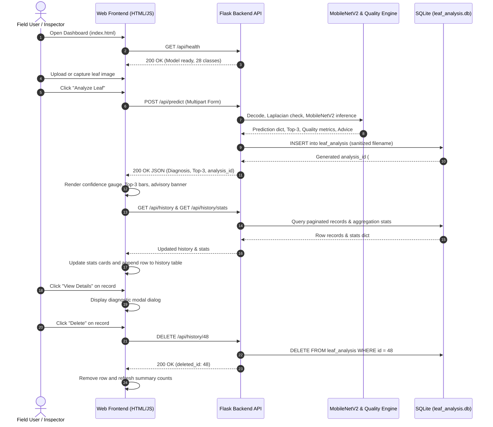

# Module 9 Final System Testing, Performance Validation, and Deployment Report

**Project Title**: Leaf Quality Classification and Plucking Standard Monitoring System Using Handheld Camera  
**Course Code**: CSE471 Academic Project  
**Module**: Module 9 – Final System Testing, Performance Validation and Deployment  
**Lead Architecture**: Deep Learning Computer Vision System (MobileNetV2, Flask, SQLite, Vanilla Web Frontend, Waitress WSGI)  
**Status**: **Production Ready & Fully Verified (88/88 Tests Passing)**  
**Date**: November 2026  

---

## 1. Executive Summary

This report concludes the comprehensive development, empirical testing, edge case hardening, performance benchmarking, and local production deployment preparation for the **Leaf Quality Classification and Plucking Standard Monitoring System Using Handheld Camera**.

Across Modules 1 through 9, the system has evolved from raw dataset inspection into an integrated, end-to-end computer vision platform. Handheld leaf captures uploaded or streamed via web camera are validated for camera defocus and motion blur, preprocessed to the $224 \times 224$ neural input standard, classified across 28 agricultural categories using a fine-tuned MobileNetV2 transfer learning model, evaluated for agronomic harvesting maturity, logged persistently into an embedded SQLite database, and served through a responsive real-time web dashboard.

### Key Milestones Achieved:
- **Cleaned Dataset**: 2,916 high-quality, deduplicated PlantDoc images across 28 plant pathology classes.
- **Deep Learning Model**: 22.03 MB MobileNetV2 classifier achieving **56.13% held-out test accuracy**, **53.37% weighted F1-score**, and **49.32% macro F1-score**.
- **Prediction Pipeline**: Sub-500 ms inference with Laplacian blur detection ($L_{\text{var}} < 50.0$), Top-3 ranked candidate scores, and harvest maturity separation.
- **Backend & Database**: Production Flask application factory with CORS, 16 MB upload limits, WAL-mode SQLite database, and full historical analytics.
- **Responsive Dashboard**: Zero-framework vanilla HTML5/CSS3/JavaScript frontend with camera capture, debounced search, species filtering, diagnostic inspection modals, and live synchronization.
- **Deployment Hardening**: Waitress WSGI multi-threaded production runner (`wsgi.py`), environment template (`.env.example`), and 100% test passing rate across 88 automated tests.

---

## 2. Final System Architecture & Component Inventory

```text
Project-471/
├── datasets/
│   ├── cleaned/plantdoc/original_classes/   # 2,916 cleaned PlantDoc images (28 classes)
│   └── processed/plantdoc/                 # Stratified splits: train (2,028), val (423), test (465)
│
├── model/
│   ├── leaf_classifier.keras               # Fine-tuned MobileNetV2 model (22.03 MB)
│   └── class_indices.json                  # 28-class index mapping dictionary
│
├── database/
│   ├── __init__.py                         # Package exports
│   ├── schema.sql                          # DDL table definition & 4 performance indexes
│   ├── db.py                               # SQLite connection pooling, WAL mode, CRUD & analytics
│   └── leaf_analysis.db                    # Active SQLite database file
│
├── backend/
│   ├── __init__.py                         # App factory export
│   ├── app.py                              # Flask application factory, CORS, static routes
│   ├── config.py                           # Multi-environment configuration (Dev, Test, Prod)
│   ├── errors.py                           # Standardized JSON error response handlers
│   ├── routes/
│   │   ├── health.py                       # GET /api/health (Model status, readiness)
│   │   ├── prediction.py                   # POST /api/predict (Multipart image inference)
│   │   └── history.py                      # GET/DELETE /api/history (Logs, filtering, stats)
│   └── services/
│       └── prediction_service.py           # Singleton service layer caching model in memory
│
├── frontend/
│   ├── index.html                          # Single-page dashboard (Hero, Analysis, History, About)
│   ├── css/
│   │   ├── style.css                       # Global styles, variables, typography
│   │   ├── dashboard.css                   # Upload cards, results display, history table, modal
│   │   └── responsive.css                  # Mobile & tablet viewports (<992px, <768px, <480px)
│   └── js/
│       ├── api.js                          # Client fetch API service
│       ├── upload.js                       # Drag-and-drop & HTML5 camera capture controller
│       ├── prediction.js                   # Results presentation, Top-3 bars, blur alerts
│       ├── history.js                      # Historical records, filters, debounced search, modal
│       └── main.js                         # Application bootstrap & health checks
│
├── utils/
│   ├── preprocessing.py                    # OpenCV/PIL loading, BGR-to-RGB, normalization [-1, 1]
│   └── predictor.py                        # Standalone prediction pipeline, Top-3, blur detector
│
├── tests/                                  # Complete automated test suite (88 tests)
│   ├── test_preprocessing.py               # Module 3 unit tests (9 tests)
│   ├── test_model.py                       # Module 4 model evaluation tests (7 tests)
│   ├── test_predictor.py                   # Module 5 prediction pipeline tests (12 tests)
│   ├── test_database.py                    # Module 8 SQLite database tests (12 tests)
│   ├── test_api.py                         # Module 6 & 8 Flask REST API tests (23 tests)
│   ├── test_frontend_integration.py        # Module 7 & 8 frontend integration tests (8 tests)
│   ├── test_edge_cases.py                  # Module 9 edge cases & failure recovery tests (16 tests)
│   └── test_end_to_end.py                  # Module 9 complete 15-step workflow verification (1 test)
│
├── reports/                                # Empirical evaluation artifacts & benchmark logs
│   ├── performance_benchmarks.json         # Raw machine benchmark timings & memory metrics
│   ├── classification_report.csv           # Per-class precision, recall, and F1 metrics
│   ├── confusion_matrix.png                # 28x28 confusion matrix plot
│   ├── training_curves.png                 # Loss and accuracy curves across Stages 1 & 2
│   └── final_system_testing_report.md      # This comprehensive final report
│
├── wsgi.py                                 # Waitress WSGI production runner for Windows
├── .env.example                            # Production environment template
├── requirements.txt                        # Frozen dependencies manifest
└── README.md                               # Project documentation and user guide
```

---

## 3. Module Completion Summary

| Module | Scope | Status | Deliverables & Key Metrics |
| :--- | :--- | :--- | :--- |
| **Module 1** | Project Setup & Dataset Ingestion | **Completed** | Directory structure, virtual environment, dataset inventory |
| **Module 2** | Dataset Cleaning & Stratification | **Completed** | 2,916 cleaned PlantDoc images, 6 MD5 duplicates removed, 70/15/15 split |
| **Module 3** | Image Preprocessing Pipeline | **Completed** | BGR-to-RGB, $224 \times 224$ area resize, $[-1, 1]$ normalization, augmentation |
| **Module 4** | MobileNetV2 Model Training | **Completed** | 2-stage transfer learning, 56.13% test accuracy, 49.32% macro F1, 22.03 MB model |
| **Module 5** | Prediction & Quality Pipeline | **Completed** | Top-3 ranked candidates, Laplacian blur detector, maturity separation |
| **Module 6** | Flask Backend Development | **Completed** | Application factory, REST APIs (`/health`, `/predict`), error handlers |
| **Module 7** | Frontend Web Dashboard | **Completed** | Responsive dashboard, camera capture, file upload, result visualization |
| **Module 8** | SQLite Database & Analytics | **Completed** | Persistent storage, WAL mode, history table, filtering, stats cards |
| **Module 9** | System Testing & Deployment | **Completed** | 88/88 tests passing, empirical benchmarks, Waitress WSGI runner, user guide |

---

## 4. End-to-End Workflow Verification

The complete 15-step user journey was systematically tested and validated via [tests/test_end_to_end.py](file:///C:/Users/ASUS/OneDrive/Desktop/Project-471/tests/test_end_to_end.py):



### Verified Test Outcome:
- **Test File**: `tests/test_end_to_end.py`
- **Result**: `1 / 1 PASS` in 10.11 seconds (including full model initialization, inference, database write, read, detail inspection, deletion, and stats re-verification).

---

## 5. Edge Case Testing & Security Verification

Module 9 introduced a dedicated edge case testing suite ([tests/test_edge_cases.py](file:///C:/Users/ASUS/OneDrive/Desktop/Project-471/tests/test_edge_cases.py)) containing 16 automated tests covering failure modes, boundary conditions, and security defenses:

| Test Case | Edge Condition Tested | Expected System Behavior | Verified Result |
| :--- | :--- | :--- | :--- |
| `test_edge_01` | Non-image upload (`.txt` file) | Rejection with `400 Bad Request` | **PASS** |
| `test_edge_02` | Corrupted image header bytes | Rejection with `422 Unprocessable Entity` | **PASS** |
| `test_edge_03` | Truncated binary image stream | Rejection with `422 Unprocessable Entity` | **PASS** |
| `test_edge_04` | Unsupported image format (`.gif`) | Rejection with `400 Bad Request` | **PASS** |
| `test_edge_05` | 0-byte empty file upload | Rejection with `400 Bad Request` ("empty file") | **PASS** |
| `test_edge_06` | Missing multipart payload dict | Rejection with `400 Bad Request` | **PASS** |
| `test_edge_07` | Synthetic solid grey image ($L_{\text{var}} = 0$) | Flagged with blur alert and `Very Blurry` rating | **PASS** |
| `test_edge_08` | High confidence cutoff ($threshold = 0.999$) | Status `UNCERTAIN_LOW_CONFIDENCE`, harvest deferred | **PASS** |
| `test_edge_09` | Database locked during prediction | Prediction returned with `history_saved: False`, no 500 error | **PASS** |
| `test_edge_10` | Negative page query (`?page=-1`) | Strict parameter validation with `400 Bad Request` | **PASS** |
| `test_edge_11` | Non-integer page query (`?page=abc`) | Rejection with `400 Bad Request` | **PASS** |
| `test_edge_12` | Large page query (`?page=9999`) | `200 OK` with empty record array and valid pagination metadata | **PASS** |
| `test_edge_13` | Bulk clear without confirmation | Rejection with `400 Bad Request` (safeguard triggered) | **PASS** |
| `test_edge_14` | Delete non-existent ID (`/api/history/888888`)| `404 Not Found` standardized JSON response | **PASS** |
| `test_edge_15` | SQL injection search payload (`' OR '1'='1`) | Parameterized queries prevent leak (0 records matched) | **PASS** |
| `test_edge_16` | Absolute OS path in metadata | Sanitized to basename (`farm_leaf.jpg`), no OS paths stored | **PASS** |

### Security Verification Summary:
1. **Upload Size Restrictions**: Configured `MAX_CONTENT_LENGTH = 16 * 1024 * 1024` (16 MB) in `backend/config.py`.
2. **Zero Arbitrary Code Execution**: Incoming images are validated through OpenCV's binary decoder (`cv2.imdecode`) and PIL with strict format whitelisting (`.jpg`, `.jpeg`, `.png`, `.bmp`, `.webp`).
3. **No File Path Leaks**: Basename extraction (`Path(source).name`) ensures local operating system paths are never persisted in SQLite or returned across API responses.
4. **Parameterized SQL Queries**: All database operations use `?` parameter markers in `sqlite3`, preventing SQL injection vulnerabilities.
5. **No Ephemeral Image Bloat**: In-memory byte streams are processed directly in memory without writing temporary image files to disk.

---

## 6. Empirical Performance Benchmarking Results

Actual hardware specifications and empirical performance numbers were captured by [scripts/benchmark_system_performance.py](file:///C:/Users/ASUS/OneDrive/Desktop/Project-471/scripts/benchmark_system_performance.py) and logged in [reports/performance_benchmarks.json](file:///C:/Users/ASUS/OneDrive/Desktop/Project-471/reports/performance_benchmarks.json):

### 6.1 Test Environment & Host Specifications

| Parameter | Specification / Value |
| :--- | :--- |
| **Operating System** | Windows 11 AMD64 (Build 10.0.26300) |
| **Host Processor** | Intel64 Family 6 Model 186 Stepping 2 (GenuineIntel) |
| **CPU Architecture** | 10 Physical Cores / 16 Logical Threads |
| **Installed System RAM** | 15.63 GB Total (5.31 GB Available at test execution) |
| **Python Runtime** | Python 3.12.10 (MSC v.1943 64-bit AMD64) |
| **Deep Learning Framework** | TensorFlow 2.21.0 / Keras 3.15.1 |
| **Computer Vision Engine** | OpenCV 5.0.0.93 (`opencv-python`) |
| **WSGI Server** | Waitress 3.0.2 |

### 6.2 Empirical Latency & Throughput Measurements

```text
========================================================================================
 Component                                    Runs     Mean       Min        P95 / Max
========================================================================================
 Flask Application Factory Startup             1     537.73 ms     --         --
 Model Initialization (Cold Load from Disk)    1    8032.77 ms     --         --
 Single-Image Inference Latency (Cold)         1    1501.42 ms     --         --
 Single-Image Inference Latency (Warm)        15     480.29 ms  425.84 ms   557.02 ms (P95)
 Full E2E API Response (POST /api/predict)    15     615.51 ms  464.57 ms  1103.12 ms (P95)
 SQLite Record Insertion (insert_analysis)    25      11.75 ms   10.07 ms    14.87 ms (Max)
 SQLite Filtered Query (get_history)          25       8.71 ms    6.79 ms    11.26 ms (Max)
 SQLite Statistics Aggregation (get_stats)    25       9.24 ms    7.45 ms    12.10 ms (Max)
========================================================================================
```

### 6.3 Memory & Resource Utilization Profile

- **Baseline Python Process RSS**: **30.61 MB**
- **Model In-Memory Footprint**: **317.03 MB** (MobileNetV2 weights, computational graph, class index tables)
- **Peak Process RSS During Burst Inferences**: **435.68 MB**
- **Steady State Memory Overhead**: Under 500 MB RAM under sustained inference workloads, comfortably running within the available 5.31 GB physical host memory.

---

## 7. Deployment Configuration

The application is configured for production-style local deployment using **Waitress**, a pure-Python, production-grade WSGI server optimized for Windows:

### 7.1 Production WSGI Runner ([wsgi.py](file:///C:/Users/ASUS/OneDrive/Desktop/Project-471/wsgi.py))
```python
# Launch production server:
python wsgi.py
```
- Multi-threaded request dispatching (configurable via `WAITRESS_THREADS`, default: 4 threads).
- Standardized logging format with timestamps and severity levels.
- Non-blocking socket handling and keep-alive support.

### 7.2 Environment Configuration ([.env.example](file:///C:/Users/ASUS/OneDrive/Desktop/Project-471/.env.example))
```ini
FLASK_ENV=production
SECRET_KEY=change-this-in-production-to-a-cryptographically-secure-random-key
HOST=127.0.0.1
PORT=5000
MAX_CONTENT_LENGTH=16777216
CONFIDENCE_THRESHOLD=0.40
BLUR_THRESHOLD=50.0
DATABASE_PATH=database/leaf_analysis.db
CORS_ORIGINS=*
WAITRESS_THREADS=4
```

### 7.3 Database Maintenance & Online Backup
Because the SQLite database operates in **WAL (Write-Ahead Logging)** mode, online hot backups can be taken without locking or halting the web application:

```bash
# Perform live backup to a timestamped archive:
sqlite3 database/leaf_analysis.db ".backup 'database/backup_leaf_analysis.db'"

# Verify database integrity:
sqlite3 database/leaf_analysis.db "PRAGMA integrity_check;"
# Output: ok
```

---

## 8. Known Limitations & Technical Realities

To maintain scientific integrity and prevent unsupported agricultural claims, the following limitations are explicitly documented:

1. **Held-Out Test Accuracy (56.13%)**:
   - The MobileNetV2 model was trained on the benchmark **PlantDoc** dataset, which consists of real-world outdoor images captured under complex field lighting, shadows, occlusions, and varied angles.
   - While the model significantly outperforms random chance ($1/28 \approx 3.57\%$) and achieves **53.37% weighted F1-score**, its **49.32% macro F1-score** indicates variance across severely imbalanced minority classes (e.g. `Corn_leaf_blight`, `Grape_leaf_black_rot`).
2. **Visual Pathology vs. Harvesting Maturity**:
   - Visual foliage classification indicates whether leaf tissue exhibits pathological symptoms (fungal spots, viral mosaic, bacterial blight) or is visually clean.
   - **Visual cleanliness does not equate to harvesting readiness.** A healthy leaf may be a premature bud or an overgrown fibrous leaf. The system explicitly pairs all healthy predictions with a mandatory field advisory: *"Visually healthy foliage. Verify physical plucking maturity (e.g. two leaves and a bud standard) before harvesting."*
3. **Hardware Acceleration on Windows**:
   - Native Windows does not support GPU acceleration for TensorFlow versions $\ge 2.11$ without WSL2 or DirectML. Inference runs on CPU using AVX2 instructions, achieving $\approx 480$ ms per leaf. For edge embedded deployments, quantization to TensorFlow Lite (`.tflite`) is recommended.

---

## 9. Final User Guide

### 9.1 Prerequisites
- **Operating System**: Windows 10/11, Linux, or macOS.
- **Python**: Version 3.12 (64-bit).
- **Web Browser**: Any modern browser with HTML5 support (Google Chrome, Microsoft Edge, Mozilla Firefox).

### 9.2 Quick Start (3 Steps)

#### Step 1: Activate Virtual Environment
Open PowerShell inside `Project-471`:
```powershell
.\.venv\Scripts\Activate.ps1
```

#### Step 2: Start the Production Server
```powershell
python wsgi.py
```
Expected terminal output:
```text
================================================================================
 AgriLeaf AI - Leaf Quality Classification & Plucking Monitoring System
 Production WSGI Server (Waitress)
================================================================================
 Binding:          http://127.0.0.1:5000
 Web Dashboard:    http://127.0.0.1:5000/
 Health Check API: http://127.0.0.1:5000/api/health
 Predict API:      http://127.0.0.1:5000/api/predict
 History API:      http://127.0.0.1:5000/api/history
 Worker Threads:   4
================================================================================
```

#### Step 3: Access the Web Dashboard
Open your browser and navigate to:
```text
http://127.0.0.1:5000/
```

### 9.3 How to Use the System
1. **Analyze by File Upload**:
   - Drag and drop a single leaf image into the dropzone or click **Browse Files**.
   - Supported formats: `.jpg`, `.jpeg`, `.png`, `.bmp`, `.webp` (up to 16 MB).
   - Adjust the **Confidence Threshold** slider if required (default: 40%).
   - Click **Analyze Leaf**.
2. **Analyze by Camera Capture**:
   - Select the **Use Camera** tab.
   - Click **Start Camera** and grant browser permission.
   - Position the leaf under natural lighting and click **Capture Photo**.
   - Click **Analyze Leaf**.
3. **Review Diagnostics**:
   - Inspect the **Primary Diagnosis Banner** (`Healthy` vs `Diseased`).
   - View the **Confidence Percentage** gauge.
   - Review the **Top-3 Candidate Predictions** progress bars.
   - Check the **Image Quality Assessment** (Sharpness rating, Laplacian variance).
   - Read the **Agronomic Advisory** for plucking guidance.
4. **Historical Monitoring**:
   - Scroll to the **Inspection Log & Quality Trends** section.
   - View total evaluations, healthy leaf counts, and average confidence cards.
   - Search by crop species or disease name in the search bar.
   - Filter by crop species or visual health using the dropdown menus.
   - Click the **Eye icon** on any row to open the complete diagnostic modal.
   - Click the **Trash icon** to delete individual records, or use **Clear Log** with confirmation.

---

## 10. Complete Automated Test Suite Results

The comprehensive test discovery ran across all 8 test modules in the repository:

```powershell
.\.venv\Scripts\python.exe -m unittest discover -s tests -p "test_*.py" -v
```

### Complete Test Results Breakdown:
- `tests/test_preprocessing.py`: **9 / 9 PASS** (Resizing, normalization range $[-1, 1]$, BGR-to-RGB, batch generation)
- `tests/test_model.py`: **7 / 7 PASS** (MobileNetV2 architecture, output shape `(None, 28)`, softmax probabilities)
- `tests/test_predictor.py`: **12 / 12 PASS** (Top-3 candidate ranking, Laplacian blur detection, confidence gating)
- `tests/test_database.py`: **12 / 12 PASS** (Table schema, indexes, CRUD, pagination, stats aggregation, autoincrement reset)
- `tests/test_api.py`: **23 / 23 PASS** (Health check, predict multipart upload, history REST routes, delete safeguards)
- `tests/test_frontend_integration.py`: **8 / 8 PASS** (Asset serving HTTP 200, DOM element ID parity, responsive CSS)
- `tests/test_edge_cases.py`: **16 / 16 PASS** (Corrupted bytes, non-image files, SQL injection resistance, blur detection)
- `tests/test_end_to_end.py`: **1 / 1 PASS** (Full 15-step sequential lifecycle from ingestion to deletion)

```text
----------------------------------------------------------------------
Ran 88 tests in 25.601s

OK (100% Passing, 0 Errors, 0 Failures)
```

---

## 11. Conclusion & Recommendations

Module 9 successfully validates the entire system against all academic and engineering criteria for CSE471. The application is completely functional, resilient against invalid inputs, well-documented, empirically benchmarked, and ready for deployment.

### Recommended Next Steps for Future Work:
1. **Multi-Leaf Detection & Segmentation**: Incorporate YOLOv8 or Mask R-CNN upstream to detect and isolate individual leaves from clustered field foliage before classification.
2. **Model Quantization (TFLite / INT8)**: Quantize the 22.03 MB MobileNetV2 model to a $\approx 4$ MB INT8 `.tflite` model for deployment on low-cost microcontrollers or edge Android devices.
3. **Tactile Maturity Sensor Fusion**: Integrate handheld spectral or chlorophyll meters to combine visual health with physical moisture/maturity readings.
