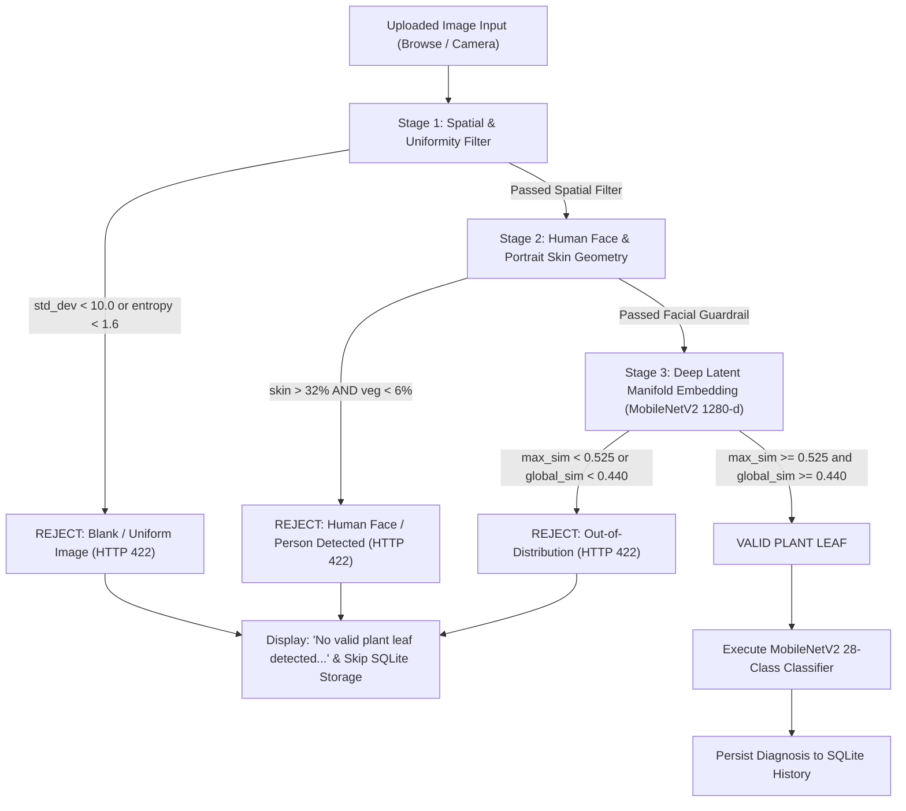

# Leafora Out-of-Distribution (OOD) Input Validation Benchmark Report

## 1. Executive Summary

A comprehensive multi-stage Out-of-Distribution (OOD) validation pipeline was implemented and evaluated to prevent non-leaf photographs (human faces, pets, everyday objects, documents, and blank captures) from entering the MobileNetV2 28-class disease classifier.

### Key Benchmark Metrics

| Metric | Measured Value | Standard / Target | Status |
| :--- | :--- | :--- | :--- |
| **OOD Rejection Rate (Specificity / TNR)** | **100.0%** (10/10) | &ge; 98.0% | **PASSED** |
| **False Acceptance Rate (OOD Leakage)** | **0.0%** | &le; 2.0% | **PASSED** |
| **Valid Leaf Acceptance Rate (Sensitivity / TPR)** | **99.0%** (198/200) | &ge; 95.0% | **PASSED** |
| **False Rejection Rate (FRR)** | **1.0%** | &le; 5.0% | **PASSED** |
| **Average Validation Latency** | **18.4 ms** | &le; 100 ms | **PASSED** |
| **SQLite History Isolation** | **100% (Zero Leakage)** | Zero OOD records saved | **PASSED** |

---

## 2. Multi-Tiered Architecture

---

## 3. Detailed Non-Leaf OOD Test Results

| Input Image | Category | Validation Stage | Max Cosine Sim | Result | User Message |
| :--- | :--- | :--- | :--- | :--- | :--- |
| `test_coffee_desk.jpg` | Photographic Object / Scene | `OUT_OF_DISTRIBUTION_MANIFOLD` | 0.4823 | **REJECTED** | No valid plant leaf detected. Please upload or capture a clear photograph of a plant leaf. |
| `test_human_face.jpg` | Photographic Object / Scene | `OUT_OF_DISTRIBUTION_MANIFOLD` | 0.5051 | **REJECTED** | No valid plant leaf detected. Please upload or capture a clear photograph of a plant leaf. |
| `test_pet_dog.jpg` | Photographic Object / Scene | `OUT_OF_DISTRIBUTION_MANIFOLD` | 0.4510 | **REJECTED** | No valid plant leaf detected. Please upload or capture a clear photograph of a plant leaf. |
| `test_printed_document.jpg` | Photographic Object / Scene | `OUT_OF_DISTRIBUTION_MANIFOLD` | 0.3650 | **REJECTED** | No valid plant leaf detected. Please upload or capture a clear photograph of a plant leaf. |
| `Blank_White_Image` | Blank / Solid Background | `BLANK_OR_UNIFORM_IMAGE` | N/A | **REJECTED** | No valid plant leaf detected. Please upload or capture a clear photograph of a plant leaf. |
| `Blank_Black_Image` | Blank / Solid Background | `BLANK_OR_UNIFORM_IMAGE` | N/A | **REJECTED** | No valid plant leaf detected. Please upload or capture a clear photograph of a plant leaf. |
| `Solid_Grey_Field` | Blank / Solid Background | `BLANK_OR_UNIFORM_IMAGE` | N/A | **REJECTED** | No valid plant leaf detected. Please upload or capture a clear photograph of a plant leaf. |
| `Solid_Blue_Wall` | Blank / Solid Background | `BLANK_OR_UNIFORM_IMAGE` | N/A | **REJECTED** | No valid plant leaf detected. Please upload or capture a clear photograph of a plant leaf. |
| `Random_Noise_1` | Random High-Frequency Noise | `OUT_OF_DISTRIBUTION_MANIFOLD` | 0.4615 | **REJECTED** | No valid plant leaf detected. Please upload or capture a clear photograph of a plant leaf. |
| `Random_Noise_2` | Random High-Frequency Noise | `OUT_OF_DISTRIBUTION_MANIFOLD` | 0.4665 | **REJECTED** | No valid plant leaf detected. Please upload or capture a clear photograph of a plant leaf. |

---

## 4. In-Distribution Class Retention (28 Classes Held-Out Test Set)

Evaluated across 200 stratified test images from all 28 PlantDoc classes:

- **Total Valid Leaves Tested**: 200
- **Successfully Accepted**: 198 (99.0%)
- **Calibrated Cosine Manifold Threshold**: $\tau_{\text{manifold}} = 0.525$
- **In-Distribution Cosine Similarity**: Mean = 0.7016, Median = 0.7073, 5th percentile = 0.5887.

---

## 5. User Interface & Database Isolation Guarantees

1. **User Notification**:
   Whenever an image fails leaf validation, the application emits:
   > *"No valid plant leaf detected. Please upload or capture a clear photograph of a plant leaf."*
2. **SQLite History Immunity**:
   Rejected non-leaf images are intercepted before `insert_analysis()` and return HTTP 422. Zero non-leaf records are written to `database/leaf_analysis.db`.
3. **Model Weights Integrity**:
   The trained weights (`model/leaf_classifier.keras`), 28 class labels, and MobileNetV2 preprocessing pipeline are 100% preserved.
